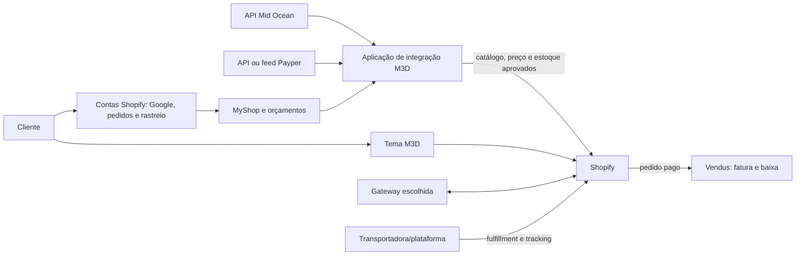

# M3D Solutions — arquitetura proposta do MVP

Versão para revisão em 22/09/2026. Prazo de lançamento: até 17/10/2026. Este documento planeia o trabalho; não altera a loja.

## Decisões do produto

- Portugal e Espanha entram no MVP, em EUR. França, Países Baixos, Itália e Reino Unido ficam para expansão posterior.
- Shopify é o sistema operacional de catálogo publicado, preços finais, estoque vendável, checkout e pedidos.
- Mid Ocean e Payper são os fornecedores a integrar. O catálogo de lançamento ainda precisa de seleção.
- Vendus emite faturas automaticamente e regista as baixas; a disponibilidade exibida ao cliente continua na Shopify.
- MyShop V1 cria listas privadas por empresa. Colegas autorizados editam a mesma lista. Cada item guarda apenas produto, variante e quantidade; na recompra, preço, estoque e personalização são consultados novamente. A publicação de mini-lojas é V2.
- “Meus orçamentos” reúne solicitações e respostas manuais. Cada orçamento é privado do solicitante. “Histórico de Encomendas” usa a conta da Shopify.
- O provedor de pagamento e a operação logística ainda não foram escolhidos.

## Situação atual

O repositório contém um tema Shopify Online Store 2.0 em Liquid, CSS e JavaScript nativo, com homepage, listagem, produto, carrinho e gateway visual de login. A autenticação usa a conta hospedada da Shopify por código de e-mail. O MyShop nos cards e na PDP ainda é demonstrativo: não persiste listas nem conhece empresas. Não há serviço de integração no repositório. Produtos a preço zero seguem para “Preço sob consulta” e não podem ser comprados pelo tema.

## Desenho de componentes

A aplicação M3D é um serviço hospedado, com armazenamento persistente, tarefas agendadas, fila/retries, logs e um painel interno simples. Ela hospeda conectores separados por fornecedor e os dados próprios de MyShop e orçamentos. Segredos ficam no servidor. A software house implementa esse serviço; o tema continua responsável pela vitrine.

| Dado | Referência operacional | Regra |
| --- | --- | --- |
| Cliente e sessão | Shopify Customer Accounts | Google é configurado no acesso hospedado; o tema não cria autenticação paralela. |
| Empresa e membros | Shopify B2B Companies, se validado na loja | Identidade por ID de empresa; fallback é associação de membros na aplicação, com convites verificados. |
| Produto, preço final e estoque vendável | Shopify | Fornecedores alimentam a aplicação; só dados normalizados e aprovados são publicados. |
| Lista MyShop e orçamentos | Aplicação M3D | Listas pertencem à empresa; orçamentos pertencem ao cliente solicitante. |
| Pedido e pagamento | Shopify | A gateway deve operar dentro do checkout compatível da Shopify. |
| Fatura fiscal | Vendus | Um documento por venda, ligado ao ID do pedido Shopify. |
| Expedição/rastreio | Shopify, alimentada pela plataforma logística | O cliente vê atualizações na conta e na página de estado do pedido. |

## Fluxos críticos

**Catálogo.** Cada conector mapeia o identificador externo e SKU/variante para um produto Shopify estável. Importações repetidas atualizam o mesmo artigo. A M3D aprova catálogo, margem, IVA, descrição e imagens antes de publicar. A personalização só apresenta técnica, posição, dimensão e limites que estejam no contrato de dados do fornecedor e tenham preço definido. Falta de preço ou configuração leva a orçamento. A sincronização registra data, falhas e SKUs afetados; não apaga variantes por ausência temporária no feed.

**Estoque.** A API do fornecedor fornece a disponibilidade física; uma regra M3D define o estoque vendável mostrado na Shopify. A venda Shopify gera evento para faturação e baixa no Vendus. O Vendus não escreve de volta na Shopify sem regra explícita de conciliação, para evitar ciclos ou venda excessiva. A cada dia, reconciliar pedidos, estoque e faturas.

**MyShop.** O cliente autenticado acessa uma página privada, cria e renomeia listas, adiciona/remove produtos e recompra. Os colegas da mesma empresa podem editar; clientes de outra empresa nunca podem ler a lista. Um piloto na primeira semana valida se Shopify B2B Companies representa corretamente essas empresas sem efeitos indesejados no checkout. A página pode ser uma extensão completa da conta; o botão “Adicionar ao MyShop” no tema comunica-se com a aplicação por canal autenticado. O servidor verifica a identidade e a empresa em cada operação.

**Orçamentos.** O pedido captura produto, variante, quantidade, opções enviadas, mensagem e dados mínimos de contacto. A M3D responde manualmente num painel interno. Só o autor vê o seu histórico e a resposta. O pedido de orçamento não cria pedido pago nem fatura. Converter orçamento aprovado em checkout é uma evolução separada.

**Pagamentos.** Selecionar uma gateway compatível com a loja Shopify e testar cartões em Portugal/Espanha, MB WAY para clientes elegíveis em Portugal, recusas, cancelamentos e reembolsos. Comparar também as taxas adicionais da Shopify para provedores externos. A mera presença de MB WAY nas configurações não prova que o fluxo esteja ativo.

**Vendus.** Testar primeiro a integração oficial para emissão automática, NIF, taxas, reembolso e duplicação de eventos. Confirmar se ela efetua a baixa desejada. Se faltar uma etapa, a software house estima uma extensão, mantendo apenas um caminho ativo de faturação.

**Logística.** Escolher operador que atenda Portugal e Espanha e publique transportadora, número e URL de rastreio no fulfillment Shopify. A conta da Shopify já apresenta esses dados ao cliente. Atualizações automáticas antes da expedição exigem uma fonte real de eventos de produção; a cobertura precisa ser acordada com a M3D.

## Confiabilidade, segurança e desempenho

- Verificar assinatura de webhooks e pedidos do storefront; deduplicar eventos, usar fila/retries e alertas. Nenhuma credencial em Liquid ou JavaScript público.
- Limitar todos os dados MyShop por empresa e os orçamentos por cliente. Definir retenção, backups, acesso da equipa e tratamento dos ficheiros de personalização.
- Medir homepage, coleção, PDP e carrinho em mobile/desktop. O asset atual `assets/vestuario.png` tem cerca de 8 MB; converter/redimensionar os maiores e servir tamanhos responsivos. Preservar a correção do carrossel.
- Usar LCP até 2,5 s, INP até 200 ms e CLS até 0,1 como metas de campo no percentil 75 quando houver tráfego suficiente. Até lá, comparar medições laboratoriais repetíveis.

## Plano e responsáveis

| Data limite | Evidência necessária | Responsável |
| --- | --- | --- |
| 25/09 | Credenciais/documentação e amostras das duas APIs; SKUs iniciais; regra de preço e personalização; shortlist da gateway e da logística; piloto de empresa/conta | M3D + software house |
| 03/10 | Primeiro subconjunto de ambos os fornecedores importado em teste com preço, estoque, imagens e variantes; MyShop com identidade compartilhada | Software house; M3D aprova conteúdo |
| 10/10 | MyShop, orçamentos, Google, pagamentos PT/ES, Vendus e tracking integrados em ambiente de teste | Software house + M3D |
| 15/10 | Testes de compras, falhas, reembolso, fatura única, isolamento entre empresas, sincronização e desempenho | Conjunto |
| 17/10 | Congelamento e decisão de lançamento após aprovação comercial e operacional | M3D |

A M3D escolhe produtos, margens, gateway e operador logístico e valida impostos/faturação com os responsáveis comerciais e fiscais. A software house implementa conectores, aplicação, MyShop, orçamentos e observabilidade. Nós mantemos tema, experiência de compra, integração visual e QA local em coordenação com a software house.

## Critérios de lançamento

1. Produtos aprovados de Mid Ocean e Payper são importados com dados reais. Nenhum preço zero é comprável; a personalização exibida corresponde às regras recebidas.
2. Um comprador português e outro espanhol concluem o checkout com a gateway escolhida; falhas e reembolsos são testados.
3. Dois membros da mesma empresa editam uma lista MyShop; outra empresa não consegue acessá-la. Recompra verifica preço e estoque atuais.
4. Uma solicitação de orçamento recebe resposta manual e aparece somente no histórico do autor.
5. Um pedido pago produz uma única fatura Vendus correta e a baixa esperada, com procedimento para cancelamento/reembolso.
6. O rastreio entra automaticamente na Shopify e fica visível ao cliente.
7. Google login, histórico de encomendas, mobile, acessibilidade e desempenho passam a revisão.

## Riscos e decisões pendentes

- Mid Ocean confirma publicamente API para produtos, estoque e impressão, mas exige conta aprovada para acesso. Não foi encontrada documentação pública de API da Payper; obter contrato, amostra e limites é o maior risco de prazo.
- Sem gateway e operador logístico selecionados, não é possível validar o checkout e o rastreio ponta a ponta.
- O conjunto de SKUs, a regra de preço, impostos, frete e o tratamento comercial de cada personalização ainda precisam de aprovação.
- Validar a adequação de Shopify B2B Companies à loja M3D e o comportamento real da integração Vendus antes de congelar o desenho.

## Referências técnicas

- Mid Ocean API: https://www.midocean.com/export/us/eur/content/customer-api
- Shopify B2B por plano: https://help.shopify.com/en/manual/b2b/getting-started/plan-features
- Extensões de conta: https://shopify.dev/docs/apps/build/customer-accounts
- Login social: https://help.shopify.com/en/manual/customers/customer-accounts/sign-in-options/social-sign-in
- MB WAY: https://help.shopify.com/en/manual/payments/shopify-payments/local-payment-methods/mb-way
- Gateways: https://help.shopify.com/en/manual/payments/third-party-providers
- Vendus: https://www.vendus.pt/ajuda/como-ativar-a-integracao-com-a-shopify/
- Rastreio: https://help.shopify.com/en/manual/fulfillment/setup/order-status-page/order-tracking
- Sincronização: https://shopify.dev/docs/apps/build/product-merchandising/products-and-collections/sync-data
- Webhooks: https://shopify.dev/docs/apps/build/webhooks/verify-deliveries
- Desempenho: https://shopify.dev/docs/storefronts/themes/best-practices/performance
