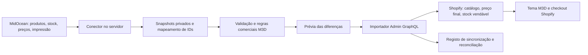

# MidOcean — arquitetura de integração M3D

09/10/2026. Escritor: Codex; revisão PDP/personalização/UX: Claude. Estado: arquitetura de servidor aceite; revisão v2 pelas novas decisões do utilizador em 09/10/2026 (§10). Integração ainda não implementada. A ordem de hoje autoriza avançar esta arquitetura; não autoriza commit, push ou deploy. Nenhuma chave, custo privado ou pedido de fornecedor foi consultado/guardado neste documento.

## 1. Decisão proposta

Seguir a aplicação M3D prevista em [arquitetura-mvp-2026.md](../arquitetura-mvp-2026.md): um serviço de servidor lê o fornecedor, normaliza e valida dados, gera uma prévia das alterações e escreve dados aprovados na Shopify via Admin GraphQL. O tema continua em Liquid/CSS/JavaScript nativo e lê produto, preço e stock da Shopify.

O primeiro executável pode ser um importador local com modo de simulação, usando as mesmas camadas do futuro serviço agendado. Não construir uma segunda arquitetura dentro de assets/. Hospedagem, linguagem do serviço e operação permanente ainda precisam de decisão; o calendário de setembro não constitui um novo compromisso de entrega.

O inventário do repositório confirma apenas o tema, sem conectores/backend implementados. A skill api-connector-builder foi aplicada para inspecionar os padrões existentes; não há dois conectores locais para comparar. Reutiliza-se a fronteira documentada no MVP, não um serviço fictício já disponível.

## 2. Contrato público do fornecedor

O [portal oficial MidOcean](https://www.midocean.com/export/us/eur/content/customer-api) confirma acesso por cliente registado/aprovado e dados de produtos, disponibilidade e impressão. O [guia de implementação MidOcean](https://midoceanbrands.atlassian.net/wiki/spaces/AIG/pages/2809659433/How%2Bto%2BConnect%2BYour%2BWebsite%2Bor%2BIT%2BSystem%2Bto%2BSOLO%2Bmidocean) identifica os seguintes feeds:

| Feed | Caminho documentado no host api.midocean.com | Atualização indicada |
| --- | --- | --- |
| Produtos | /gateway/products/2.0?language=pt | Diária |
| Stock | /gateway/stock/2.0 | Horária |
| Preços de produto | /gateway/pricelist/2.0/ | Diária |
| Preços de impressão | /gateway/printpricelist/2.0/ | Diária |
| Opções de impressão | /gateway/printdata/1.0 | Diária |

O guia indica apitest.midocean.com e chave própria para testes; a lista de preços é específica do cliente. Estes são endpoints documentados, não respostas autenticadas verificadas. A abertura direta do Confluence não devolveu conteúdo legível à ferramenta; os detalhes vieram do conteúdo indexado do próprio guia. Confirmar com a documentação/amostras da conta antes de implementar. Frequência do feed não prova stock instantâneo nem define o intervalo de polling permitido.

Não assumir cabeçalhos de autenticação, limites, paginação, nomes dos campos, moeda/unidade monetária ou modelo de erros: obter os contratos reais. A primeira fase lê estes cinco feeds; criação de encomendas, aprovação de provas e envio de artes ficam fora dela.

## 3. Dados normalizados e autoria

Os nomes abaixo são o contrato interno proposto, não nomes garantidos na resposta MidOcean.

| Grupo | Normalização interna | Destino e regra |
| --- | --- | --- |
| Identidade | supplier, external_product_id, external_variant_id, SKU original | Base privada relaciona IDs estáveis com product/variant/inventoryItem IDs Shopify. SKU isolado não identifica toda a importação. |
| Produto | títulos PT, descrição tratada, material, categoria, documentos, imagens | Shopify produto/media e campos públicos aprovados; preservar revisão editorial e dimensões/imagens reais. Não associar por título. |
| Variante | cor/tamanho/opções ordenadas, SKU, GTIN/peso quando presentes | Variante Shopify; ordem e valores consistentes. Normalizar Tamanho para a composição atual. |
| Stock | quantidade física, armazém, previsão futura, instante de origem | Snapshot privado; regra M3D transforma em stock vendável por localização Shopify. Entrada futura não é disponibilidade imediata. |
| Custo | preço contratual, moeda, escalões e condições | Apenas servidor; não copiar custo de compra para preço de venda ou metafield público. |
| Impressão | ID técnico, posição, dimensões, cores, templates e custo de preparação | Servidor guarda contrato completo; tema recebe só possibilidades públicas e comercialmente suportadas. |
| Auditoria | fetched_at, hash, schema_version, execução, aprovação, erros por artigo | Base privada; permitir reconciliar e repetir sem duplicar. |

Proposta de responsabilidade: conector controla dados técnicos de fornecedor; M3D controla seleção, descrição editorial, preço final, margens, impostos e publicação. O importador não sobrescreve automaticamente os campos editoriais. Definir a lista de campos por responsável antes de qualquer escrita real.

## 4. Mapeamento para a PDP atual — revisão aceite pelo Claude

**O parágrafo seguinte descreve limitações do tema atual, não regras comerciais. As novas decisões do utilizador em §10 revogam a restrição a sete técnicas/uma posição.**

Contrato verificado em sections/main-product.liquid e assets/m3d-product.js:

- Produto, opções, media, preço e disponibilidade vêm da Shopify. A configuração usa custom.printing_techniques e custom.personalization_config; material/documento têm campos próprios.
- A configuração atual espera techniques[] com name, price_included e positions[]; posição tem name, image HTTPS opcional, max_width_mm e max_height_mm. Definições remotas/tipos ainda não foram verificados.
- A limitação por sete nomes foi retirada após a nova ordem. Liquid lê técnicas diretamente de personalization_config; só opções cujo custo já está incluído podem ser selecionadas no carrinho atual. As demais são oferecidas por orçamento até validar preço no servidor. O importador usa tabela ID fornecedor → nome PT, conservando o ID no servidor.
- A interface permite uma técnica/posição e dimensões inteiras; não representa várias posições, cores, escalões, custo de preparação ou restrições por variante. Não declarar cobertura completa da MidOcean.
- price_included=true só se aplica quando o preço de venda realmente inclui essa opção. Não usar essa flag para tornar impressão extra aparentemente gratuita. Até existir cálculo/cobrança validada no servidor, impressão com custo variável segue para orçamento.
- Propriedades do carrinho e parâmetros de orçamento são descritivos, não validam preço/configuração no servidor. O fornecedor nunca recebe uma encomenda automática a partir deles nesta fase.

Sequência para dados personalizados: conferir as definições existentes e a autoria; criar definições ausentes com tipo/acesso correto; escrever valores aprovados; reler e validar com a PDP. Manter o contrato custom existente para compatibilidade. Novos campos internos da futura app terão definições próprias; custos e credenciais não serão públicos. Nenhuma definição foi criada agora.

Pedido ao Claude: confirmar nomes PT-PT, apresentação das posições, limites de cor/tamanho e estados sem dados; indicar o que cabe no seletor atual e o que precisa de orçamento/novo contrato. Não ativar técnicas não suportadas só para preencher o visual.

## 5. Preço e disponibilidade

Regra proposta: custo fornecedor → política comercial M3D aprovada → preço final Shopify. Margem, arredondamento, impostos, transporte, preparação e escalões não estão definidos neste documento. Preservar descontos/totais Shopify; nenhum preço fictício será publicado.

Preço em falta não se transforma automaticamente em zero publicado: artigo novo fica em rascunho; artigo existente conserva o valor aprovado e entra em revisão. Consulta deve ser um estado comercial deliberado, não fallback de erro da API. A proteção atual no tema é da interface; o acesso direto ao checkout exige desenho próprio para artigos de consulta.

Stock: localização dedicada ao fornecedor, regras de reserva/segurança e autoridade de escrita acordadas. Um feed antigo não pode repor unidades já vendidas/reservadas. Persistir alterações Shopify pendentes de confirmação do fornecedor e reconciliar a janela temporal. Se a fonte falhar, não publicar stock zero por defeito nem manter indefinidamente vendas sem regra de expiração aprovada.

## 6. Escritas Shopify e confiabilidade

Fixar uma versão Admin GraphQL suportada e validar o schema antes de gerar operações. O [productSet](https://shopify.dev/docs/apps/build/product-merchandising/products-and-collections/sync-data) substitui conjuntos de opções/variantes: ausentes do input podem ser removidos. Não enviar feed parcial como estado completo; preservar dados fora da autoria do conector. Usar atualização específica quando a operação é apenas preço/stock.

Para inventário, a documentação de [inventorySetQuantities](https://shopify.dev/docs/api/admin-graphql/latest/mutations/inventorySetQuantities) exige autoridade da fonte, controlo de concorrência e chave idempotente desde 2026-04. Confirmar os nomes de campos da versão fixada antes da implementação; não copiar exemplos antigos de latest. A chave de cada operação e o resultado ficam persistidos; erro incerto exige leitura/reconciliação antes de repetir.

Cada execução: ler → validar snapshot completo → comparar → gerar plano → aplicar apenas âmbito autorizado → reler → registar resultado. Retentativas limitadas, espera com jitter, respeito a Retry-After/limites do contrato, quarentena por artigo e alerta para erro persistente. Não apagar variantes por ausência temporária. Webhooks/cron ficam para a implementação do serviço, sem presumir eventos disponibilizados pelo fornecedor.

Antes de importar para a PDP atual, verificar o número de variantes: a serialização percorre product.variants sem paginação, cujo [acesso Liquid](https://shopify.dev/docs/api/liquid/objects/product) retorna no máximo 250 variantes. Artigos acima dessa capacidade ficam fora do piloto até adaptar seleção/carregamento; não reduzir silenciosamente o catálogo.

## 7. Primeiro piloto e critérios de aceitação

1. Documentação da conta, amostras sem segredos e subconjunto aprovado: produto simples, cores, tamanho, consulta e impressão.
2. Parser/normalização com fixtures reais expurgadas; validar ligações entre feeds, moedas, unidades, múltiplos e stock previsto.
3. Simulação gera diferenças legíveis sem chamar mutations. Segunda execução do mesmo snapshot produz zero diferenças.
4. Testar fornecedor indisponível, autenticação recusada, resposta parcial, limite de chamadas, stock expirado e artigo descontinuado.
5. Após âmbito de escrita autorizado, importar primeiro rascunhos numa loja de teste identificada; reler os IDs/preços/stock e conferir variantes e PDP. Uma prévia de tema não isola o catálogo da loja.
6. Repetição, erro incerto e venda concorrente não duplicam produto nem repõem reserva. Publicação no catálogo/Online Store permanece ação separada.

## 8. Pendências concretas

Documentação efetiva da conta e amostras dos cinco feeds; chave em ambiente de servidor protegido; acesso Admin da futura app; SKUs do piloto; preços/margens e escopo de personalização; localização/regras de stock; política de dados expirados; definições dos metafields existentes; hospedagem/responsável operacional. Segredos não são enviados pelos ficheiros de colaboração nem colocados no tema.

Próxima entrega após revisão: contrato de dados versionado + relatório de simulação com amostras reais, antes de qualquer importação remota. Este documento não significa que já tenha sido feita uma ligação autenticada ou que o catálogo esteja sincronizado.

## 9. Decisões conjuntas M1–M7 e piloto — 09/10/2026

Parecer integral: [revisão Claude](claude-status.md), secção «Revisão Claude — MidOcean §4». Registo do aceite inicial. **As partes de M1/M3 que limitavam técnicas/posições e a política de M7 são substituídas pelas decisões posteriores em §10.**

| ID | Contrato aceite | Estado |
| --- | --- | --- |
| M1 | Sete técnicas atuais, nomes PT-PT com inicial maiúscula e mapeamento explícito no servidor. Tampografia, Gravação a laser, Impressão digital UV, Doming e Gravação a seco só entram no seletor após decisão comercial do utilizador; técnicas fora da lista aparecem no acordeão como Disponível por orçamento. | Tema distingue técnica suportada/orçamento; nomes finais dependem do importador e da oferta aprovada. |
| M2 | Importar imagens de posição para Shopify Files, sem hotlink ao fornecedor. Cartão com nome PT, imagem 240 × 144 quando existe e Área máx. 60 × 40 mm; sem imagem não há placeholder. | Área máxima e rótulos no modal implementados; importação de imagens ainda não executada. |
| M3 | Uma técnica com preço incluído, uma posição e dimensões inteiras dentro do máximo. Cores de impressão, múltiplas posições, preparação, escalões e restrições por variante seguem para orçamento. max_colors/variants[] ficam para novo contrato informativo. | Modal com link contextual de orçamento; nenhum novo seletor de cores de impressão. |
| M4 | Sem printdata: ocultar bloco e acordeão. Com dados sem opção incluída: Personalização disponível por orçamento e link, mesmo com preço positivo. Stock atual em unidades em stock; previsão/falha decididas pelo servidor. | Estados do tema ajustados; regra de validade do feed pendente. |
| M5 | Cores como pílulas de texto; hex só aprovado. Imagem associada à variante e alt PT título — cor. | Pílulas uniformizadas; associação/alt editorial dos novos artigos a validar na importação. |
| M6 | Descrição PT revista e especificações em lista de definições: material, dimensões, peso e embalagem reais. | PDP já usa dl; novos campos dependem do contrato real, sem inventar dados. |
| M7 | Um preço final Shopify na PDP. Sem tabela de escalões ou compare_at_price fictício. Quantidades/condições fora da oferta aprovada seguem para orçamento. | Política comercial ainda por definir; não inferir primeiro escalão a partir do tema. |

Piloto proposto: um saco, uma garrafa ou caneca com várias posições e um têxtil com tamanhos. SKUs concretos e âmbito de escrita ainda não autorizados. Fixtures incluem produto sem printdata, técnica fora da lista, posição sem imagem e técnica variável num artigo com preço positivo. Imagens e dados de fornecedor não são pedidos no browser durante estas fixtures. Próximo passo continua a ser contrato versionado e simulação com amostras reais expurgadas, antes de qualquer importação.

## 10. Revisão v2 — novas decisões do utilizador em 09/10/2026

Prevalece sobre restrições anteriores de M1/M3/M7. Fonte: claude-status.md, «Testes de personalização, envio de imagem, filtros e novas decisões».

### P-A — Todas as técnicas e várias personalizações

Todas as técnicas reais aplicáveis ao artigo devem estar disponíveis, com nome PT e as condições do fornecedor. Não limitar a sete técnicas. Não significa permitir uma técnica numa posição/material que o fornecedor não suporta. As listas fixas dos filtros e da PDP foram retiradas; o seletor atual ainda é uma implementação de um único item e não representa esta capacidade nova. Não declarar o tema pronto para várias personalizações.

Contrato v2 proposto para o pedido: produto/variante Shopify, quantidade, lista personalizations[] com ID próprio, technique_id, position_id, width_mm, height_mm, número/códigos de cores quando exigidos e upload_id próprio por item. IDs técnicos ficam no protocolo da app; o cliente vê nomes PT. Servidor valida cada item contra printdata e variante atuais, disponibilidade, dimensões, número de cores e combinações compatíveis. Não confiar em propriedades/quantidades/preço enviados pelo browser.

UX aceite como direção: lista com Adicionar personalização e ações Editar/Remover; modal edita um item sem substituir os restantes. Cada item mantém o seu logótipo. Resumo no carrinho com propriedades numeradas; JSON/ID privado da configuração para reconciliação, sem custos privados. Seleção e preço de todas as personalizações têm de permanecer associados à mesma linha/configuração; linhas com artes diferentes não se fundem só por SKU. Adaptação Liquid/JS e desenho do checkout precisam desta versão do contrato e solução de preço no servidor.

Upload comprovado pelo Claude: PNG de fixture chegou à linha de carrinho através do armazenamento Shopify, depois a linha foi removida. Isto confirma uma arte no fluxo atual, não uma lista de vários ficheiros nem encaminhamento ao fornecedor. Upload de orçamento futuro pertence à app; até lá o formulário informa que o logótipo pode ser enviado em resposta ao e-mail.

### P-B — Fórmula e escalões

Política recebida: preço = (fornecedor + impressão) × fator. Fatores1,60 /1,50 /1,40 /1,35 conforme quantidade. **Resposta confirmada do utilizador:**1–199 ×1,60;200–499 ×1,50;500–1999 ×1,40;2000+ ×1,35. O IVA é acrescentado ao preço líquido, e o preço final é apresentado com IVA incluído. Fórmula correta: líquido=(fornecedor+impressão)×fator; bruto=líquido×(1+taxaIVA). Configuração da loja e regra por destino em [IVA](midocean-iva.md); não adicionar IVA duas vezes.

Fatores são multiplicadores sobre a base, não margens percentuais sobre a venda. Normalizar custos e moeda antes da conta, incluindo impressão de cada posição/técnica e preparação uma vez por configuração quando o contrato assim exigir. Transporte/handling e mínimos do fornecedor ainda precisam de identificação nas amostras; não duplicar custos por arte ou omiti-los silenciosamente. Arredondamento e IVA só depois de fixar a base/unidade; guardar versão da política e snapshot que geraram cada cotação.

A equivalência relativa à base1,60 é −6,25%, −12,5% e −15,625%. Só é exata se a base de custo for idêntica em todos os escalões; se a pricelist/printpricelist variar com quantidade, o desconto fixo não reproduz (custo atual × fator atual). Preparação e múltiplas artes não cabem num único preço de variante fixo sem modelação adicional.

Verificação Admin só leitura: loja Grow, shopifyPlus=false, partnerDevelopment=false. [Análise de viabilidade e fontes](midocean-precos-viabilidade.md). App própria com Functions e lineUpdate de Cart Transform não são a base do projeto neste plano. Avaliar descontos nativos/app pública para subconjunto de preço fixo e draft orders cotados no servidor para configurações variáveis; não ativar qualquer desconto nem mudar plano nesta etapa. Não criar variantes/preços temporários globais para cada carrinho.

A quantidade que determina o fator precisa de regra explícita por artigo/configuração, incluindo soma ou não de cores/tamanhos. Catálogo B2B e descontos por variante não são automaticamente equivalentes a essa soma nem ao B2C. Faixas/IVA/SKU estão decididos. Agrupamento por artigo/configuração e tratamento de preparação continuam a depender da regra comercial/contrato real.

### P-C/P-D — Marca M3D e seleção manual

Todos os novos artigos MidOcean importados terão SKU com marca M3D. Formato opaco M3D-{categoria}{sequência}-{cor} confirmado pelo utilizador (opção A); referência externa apenas no mapeamento privado. Mapeamento externo original permanece na base privada, com unicidade/estabilidade por variante; não renumerar SKU quando título/tradução mudar. Nenhum SKU existente foi alterado.

Só importar produtos escolhidos manualmente. Fase1: lista de referências de fornecedor → revisão → simulação → rascunhos Shopify; publicação manual. Ler um feed inteiro por exigência do contrato não autoriza importar todos os artigos. Fase2: catálogo de seleção na app M3D, com filtros, imagens e prévia do preço aprovado. Piloto aceite pelo utilizador: saco, garrafa/caneca com várias posições e têxtil com tamanhos; referências concretas a selecionar.

### P-E/P-F — Filtros e orçamento

Material, técnica, cor e etiquetagem dependem de dados tipados e configuração Search & Discovery. O importador deve preencher só os campos comprovados; criar definição de etiquetagem após conhecer o dado real. Shopify considera disponível um artigo com inventário não controlado: isso não prova stock físico MidOcean. A regra de inventário/autoridade do §5 deve preceder uma promessa Em stock. Não inventar valores no tema para fazer filtros parecerem completos.

Orçamento mantém contact nativo; upload independente exige endpoint da app, armazenamento privado e referências controladas. Não acrescentar file input que o formulário de contacto não sabe enviar.

### Hospedagem e próxima entrega

Recomendação: Node.js/TypeScript no Railway, PostgreSQL privado e R2 privado para snapshots/artes; região Amsterdam. Orçamento estimado US$10–15/mês para piloto de um operador e US$20–30/mês no Pro para equipa/produção, sujeito a medição dos feeds. [Comparação, fontes e cálculo](midocean-hospedagem.md). Chave MidOcean como secret/variável protegida do serviço, fora do tema, Git e ficheiros de colaboração. Nenhuma conta/serviço/instância foi criada e nenhum segredo foi solicitado no chat.

Próxima entrega concreta: contrato v2 + fixtures expurgadas, seleção manual do piloto e simulação de custos/escalões/múltiplas artes. Cobrança deve ser validada na Shopify antes de ativar compra com preço variável. A arquitetura continua sem ligação autenticada ou importação remota.

### Resposta à spec P-A e decisão de operação

[Spec P-A do Claude](../design/p-a-personalizacoes.md) recebida. Codex aceita lista/editor/reutilização de arte/a11y como direção. [Parecer técnico](codex-p-a-review.md) delimita posição incompatível, preço por destino/configuração e cobrança no Grow; pedido de revisão enviado ao Claude. A spec não comprova implementação.

Railway Amsterdam + PostgreSQL + R2 aceite pelo utilizador e pelo Claude; escolha delegada ao Codex. Conta e pagamento em nome/controlo do utilizador, com [passos curtos](midocean-contas.md). Autorização de criar conta não altera a proibição de deploy. Nenhuma conta/pagamento/serviço foi criado pelo Codex nesta etapa.

### Verificação fiscal e implementação local

Admin somente leitura confirma taxesIncluded=true, EUR; não prova registos/Markets/overrides. [IVA](midocean-iva.md) define líquido × (1+taxa) e a reconciliação com a Shopify. Taxas normais portuguesas não são escolhidas só pelo endereço de entrega; cadeia de fornecimento, origem e enquadramento determinam a regra aplicável. Não acrescentar IVA duas vezes nem habilitar compra variável com base em estimativa do browser.

Núcleo puro em [integracoes/midocean/](../integracoes/midocean/README.md), isolado e excluído do envio de tema. Recebe custos unitários e taxa explícitos, calcula os fatores confirmados e testa limites/precisão; não interpreta feeds, não resolve jurisdição nem faz rede. Arredondamento e agrupamento são propostas de simulação a reconciliar, não regras comerciais presumidas. Próximo passo: contratos/amostras reais expurgadas e relatório de diferenças, antes de qualquer escrita Shopify.

### Contas prontas e piloto de cinco artigos

Utilizador confirmou Railway/Cloudflare R2 configurados em seu nome. Piloto passa a saco, garrafa, caneca e duas peças de vestuário, substituindo o subconjunto inicial de três. Referências ainda não escolhidas; MO9846 é apenas candidato público do Claude. Aceite shortlist da primeira leitura Products PT cruzada com printdata, sem importação; o runner ainda não existe nem foi executado.

[Passos de credenciais e acesso](midocean-acessos.md): chave selada no serviço Railway, app Admin inicialmente read_products, client credentials só se app/loja mesma organização. Configuração/instalação da app e execução do backend têm limites de autorização próprios; não presumir que contas prontas autorizam deploy. Repositório privado separado recomendado, tecnicamente não obrigatório. Criação remota/commit/push/deploy continuam sem autorização; codebase local permanece intacta.
